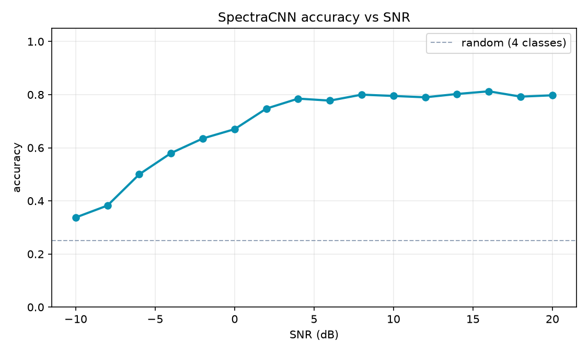
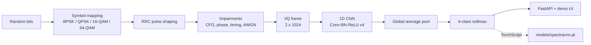

# SpectraCNN — RF Modulation Classification for 5G/6G

[](https://github.com/MoLoUiSsS/spectracnn/actions/workflows/ci.yml)
[](https://www.python.org/)
[](https://pytorch.org/)
[](LICENSE)
[](Dockerfile)

A 1D convolutional neural network that identifies **BPSK, QPSK, 16-QAM and 64-QAM** from raw I/Q samples under noise, carrier offset and timing error. It ships with a synthetic signal generator, per-SNR evaluation, TorchScript export, a FastAPI service and an interactive constellation demo.

> **Why this project?** Automatic modulation classification is a real 5G/6G and cognitive-radio problem. It combines digital communications (pulse shaping, IQ, SNR) with deep learning and MLOps, and complements my CCNA/CCNP and 5G network-slicing background.

## Results

Trained on 6,000 synthetic frames (1,500 per modulation), evaluated on a held-out test split and on fresh frames at each SNR.

| Metric | Value |
| --- | --- |
| Test accuracy (mixed SNR −10…20 dB) | **69.89%** |
| Macro F1 | **67.31%** |
| Accuracy at 10 dB | **79.50%** |
| Accuracy at 0 dB | **67.00%** |
| Parameters | **93,636** |

Artifacts: [`reports/metrics.json`](reports/metrics.json), [`reports/per_snr.csv`](reports/per_snr.csv), [`reports/per_snr.png`](reports/per_snr.png), [`reports/confusion_matrix.png`](reports/confusion_matrix.png).



At 10 dB the model classifies BPSK and QPSK perfectly and reaches 79% on 16-QAM.
64-QAM is the bottleneck (38% recall, mostly confused with 16-QAM); closing that
gap is the main modelling item on the roadmap.

## Demo

```bash
uv run spectracnn-serve
# open http://localhost:8000  -> choose a modulation and SNR, press "Classify"
# API docs: http://localhost:8000/docs
```

The page draws the received constellation, calls `/demo`, and shows the predicted modulation with per-class probabilities.

## Architecture

See [`docs/architecture.md`](docs/architecture.md) for request lifecycles, design decisions and failure modes.



**Signal chain:** bits → complex symbols → RRC pulse shaping (β=0.35, 8 samples/symbol) → carrier frequency offset, phase rotation, timing offset and AWGN at a sampled SNR → unit-power 2×1024 tensor → CNN.

## Model

| Block | Output | Details |
| --- | --- | --- |
| Conv1d + BN + ReLU + MaxPool | 32 × 512 | kernel 7 |
| Conv1d + BN + ReLU + MaxPool | 64 × 256 | kernel 5 |
| Conv1d + BN + ReLU + MaxPool | 128 × 128 | kernel 3 |
| Conv1d + BN + ReLU + MaxPool | 128 × 64 | kernel 3 |
| Adaptive average pool | 128 | translation robustness |
| Linear → ReLU → Dropout → Linear | 4 | 64 hidden units |

Training: AdamW (`lr=1e-3`, `weight_decay=1e-4`), cosine schedule, label smoothing 0.05, early stopping on validation accuracy.

## Quickstart

```bash
uv venv --python 3.12
uv pip install torch --index-url https://download.pytorch.org/whl/cpu
uv pip install -e ".[dev,mlops]"

uv run spectracnn-train                 # ~5-10 min on CPU
uv run spectracnn-serve                 # http://localhost:8000
```

Using `make`:

```bash
make install
make train
make serve
make test
```

### Docker

```bash
docker build -t spectracnn:latest .
docker run -p 8000:8000 spectracnn:latest
```

The image bundles the trained TorchScript demo model.

## API

Classify a frame (1,024 I/Q pairs). The easiest way to build a valid payload is to reuse the signal generator:

```bash
uv run python - <<'PY'
import json
import urllib.request

import numpy as np

from spectracnn.signals import generate_sample

frame = generate_sample("16QAM", length=1024, snr_db=10.0, rng=np.random.default_rng(0))
body = json.dumps({"iq": frame.T.tolist()}).encode()
request = urllib.request.Request(
    "http://localhost:8000/predict",
    data=body,
    headers={"Content-Type": "application/json"},
)
print(urllib.request.urlopen(request).read().decode())
PY
```

`iq` must contain exactly 1,024 pairs; the API rejects other lengths with 422. You can also inspect the contract interactively at `/docs`.

Generate a demo frame and classify it:

```bash
curl "http://localhost:8000/demo?modulation=16QAM&snr_db=10"
```

```json
{
  "modulation": "16QAM",
  "confidence": 0.98,
  "probabilities": {"BPSK": 0.0, "QPSK": 0.01, "16QAM": 0.98, "64QAM": 0.01},
  "true_modulation": "16QAM",
  "snr_db": 10.0,
  "constellation": [[0.21, -0.19], [-0.44, 0.33]],
  "model_version": "0.1.0",
  "latency_ms": 8.4
}
```

| Method | Path | Description |
| --- | --- | --- |
| `GET` | `/` | interactive demo |
| `GET` | `/health` | liveness + model status |
| `GET` | `/model/info` | architecture, classes, metrics |
| `POST` | `/predict` | classify 1,024 I/Q pairs |
| `GET` | `/demo` | generate and classify a frame |
| `GET` | `/docs` | Swagger UI |

Set `SPECTRACNN_API_KEY` to require `X-API-Key` on `/predict`.

## MLOps

- **Tracking:** `uv run spectracnn-train --mlflow`; inspect with `uv run mlflow ui --backend-store-uri sqlite:///mlflow.db`.
- **Serving artifact:** TorchScript (`models/spectracnn.pt`) + JSON metadata (classes, frame length, metrics).
- **Tests:** signal generator, model/trace, API and input validation.
- **CI:** Ruff + pytest on Python 3.11/3.12 with the CPU PyTorch wheel, plus a Docker build.
- **Config:** `SPECTRACNN_*` environment variables (see `src/spectracnn/config.py`).

## Project layout

```text
spectracnn/
├── src/spectracnn/
│   ├── signals.py      # modulation, RRC, impairments, AWGN
│   ├── dataset.py      # torch Dataset + stratified splits
│   ├── model.py        # 1D CNN, TorchScript save/load
│   ├── train.py        # training + per-SNR evaluation + MLflow
│   ├── api.py          # FastAPI app factory
│   ├── asgi.py         # uvicorn entrypoint
│   ├── schema.py       # Pydantic models
│   └── config.py       # env settings
├── web/index.html      # zero-dependency demo UI
├── tests/              # pytest suite
├── docs/               # model card, architecture
├── notebooks/          # constellation exploration
├── models/             # TorchScript + metadata
└── reports/            # metrics, CSV, plots
```

## Limitations

- Synthetic channel: AWGN plus CFO/phase/timing. No multipath fading, sampling clock drift, IQ imbalance or hardware nonlinearities.
- Four linear modulations only; no APSK, OFDM subcarrier effects or burst detection.
- Accuracy at very low SNR is close to chance; the model is not a substitute for a real SDR testbed.
- See the [model card](docs/model_card.md) before reusing the model.

## Roadmap

- [ ] Add multipath Rayleigh/Rician fading and IQ imbalance.
- [ ] Compare CNN against a classical higher-order-cumulant baseline.
- [ ] Export ONNX and benchmark INT8 inference.
- [ ] Validate on RadioML 2018.01A and over-the-air captures.

## License

MIT © 2026 Hammadi Mohammed
