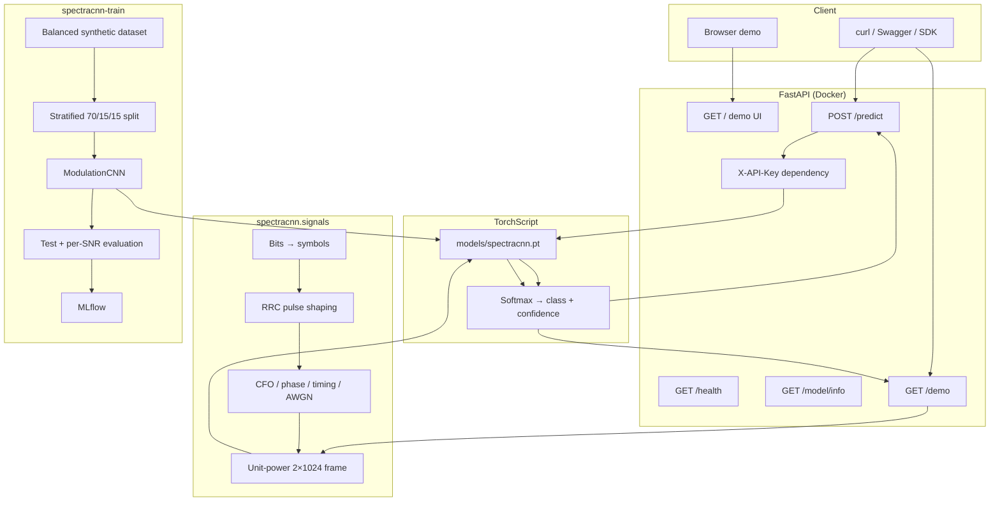

# Architecture

## Components

## Request lifecycle

### `POST /predict`

1. FastAPI validates the JSON body with Pydantic (`iq`: 64–8,192 pairs, unknown
   fields rejected).
2. Optional `X-API-Key` check.
3. The handler enforces exactly the frame length stored in the model metadata
   (1,024 in production, 256 in the tiny test bundle).
4. Samples are converted to `float32`, normalized to unit power, transposed to
   `(1, 2, length)` and passed to the TorchScript module.
5. Softmax produces four probabilities; the argmax label and confidence are
   returned with server-side latency.
6. Zero-power or malformed frames return 422; a missing artifact returns 503.

### `GET /demo`

1. The server draws a random modulation (or uses the query parameter) and a
   requested SNR.
2. `signals.generate_sample` builds a fresh impaired frame.
3. The same TorchScript predictor classifies it.
4. The response includes the predicted and true modulation, probabilities,
   latency and a 256-point constellation for the browser canvas.

## Design decisions

| Decision | Rationale |
| --- | --- |
| Synthetic generator instead of a downloaded dataset | Reproducible, licence-free, tiny repo; every impairment is inspectable and testable. |
| Explicit DSP chain | Shows pulse shaping, CFO, timing and AWGN rather than hiding them in a black box. |
| 1D CNN on raw I/Q | Learns filters directly from samples; standard strong baseline for AMC. |
| Adaptive average pooling | Robust to small timing shifts; decouples the head from frame length. |
| Per-SNR evaluation | Aggregate accuracy is misleading; the curve exposes the noise threshold. |
| TorchScript artifact | Single-file, dependency-light serving; no training code needed in the image. |
| App factory + settings injection | Tests can use a 256-sample tiny model and temp paths without global state. |
| Demo endpoint generates on the server | The browser never needs NumPy or a signal-processing stack. |
| Zero-dependency HTML UI | One file, no build step, works offline inside the container. |

## Failure modes

| Failure | Behaviour |
| --- | --- |
| Model artifact missing | Startup logs a warning; `/health` and predictions return 503. |
| Wrong frame length | 422 with the expected and received lengths. |
| Zero-power frame | 422 with a clear message. |
| Unknown modulation in `/demo` | 422 listing the valid classes. |
| Wrong API key | 401 when `SPECTRACNN_API_KEY` is set. |
| TorchScript load failure | Startup fails loudly rather than serving random weights. |
| Very low SNR | The model still answers, but accuracy approaches chance; the UI shows the true label for comparison. |

## Scaling path

- Replace the synthetic generator with a PCAP/SDR ingestion service and a feature
  store; keep the same serving contract.
- Export to ONNX Runtime and benchmark INT8 for edge radios.
- Add batch inference and a streaming endpoint for continuous spectrum monitoring.
- Track experiments in Azure ML or a hosted MLflow registry; promote artifacts by
  stage instead of copying files.
- Add Prometheus metrics, drift monitors on noise floor and input power, and
  Grafana dashboards.
- Deploy on Kubernetes with a GPU node pool for training and CPU-only replicas
  for inference.
